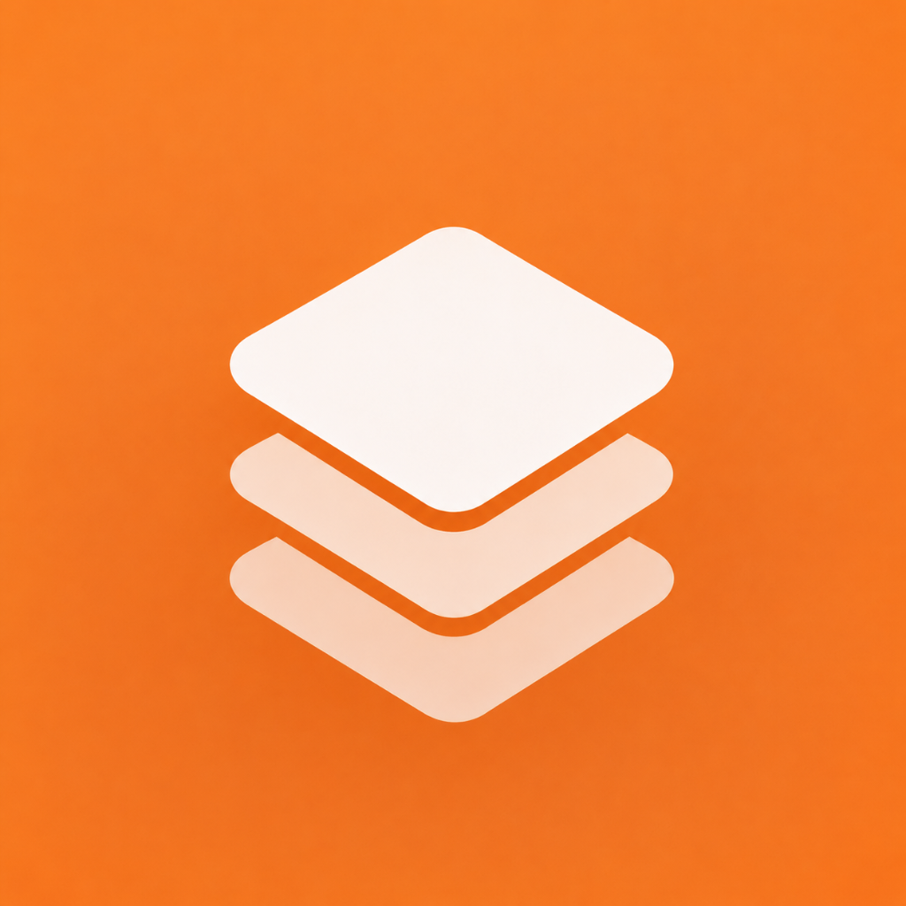

   

  

  <h1>GestaltHub</h1>

  
<b>MobileGestalt, all in one place.</b>

  
by Thanking157

  

    A free, open-source MobileGestalt customization tool for iOS / iPadOS :3
  

  

    Bringing various MobileGestalt keys together so you can easily manage and customize your device's features! 
    No need to search for different customization tools anymore w
  

  [GitHub Repository](https://github.com/Thanking157/GestaltHub) · [Releases](https://github.com/Thanking157/GestaltHub/releases) · [繁體中文](README.md)

---

## About GestaltHub

GestaltHub is a free, open-source MobileGestalt customization tool for iOS / iPadOS that I made!

I hope to bring various MobileGestalt keys and device feature settings together in one app, so everyone can customize and manage their devices more conveniently without having to download multiple tools :D

The goal is to make MobileGestalt customization simpler and more convenient w

## ✨ Features

- 📱 **MobileGestalt Key Management** — View, modify, and manage various MobileGestalt keys.
- 🏝️ **Dynamic Island / AOD** — Adjust Dynamic Island, Always-On Display, and related display features.
- 🖥️ **iPadOS UI / Stage Manager** — Modify iPadOS interface and multitasking-related settings.
- 🤖 **Apple Intelligence** — Manage Apple Intelligence and related system feature keys.
- 🌎 **Region and System Settings** — Modify device region, model information, and system-related settings.
- 💾 **Automatic Backup and Restore** — Automatically back up settings before modifications, with backup management and restore options.
- 📋 **Logs** — View activity logs and modification status.

Some features are still experimental, and actual results may vary depending on the device model and iOS / iPadOS version.

## 📲 Installation

GestaltHub provides an unsigned IPA that must be signed using your own signing tool before installation!

**Download:**

Go to [GitHub Releases](https://github.com/Thanking157/GestaltHub/releases) and download `GestaltHub-unsigned.ipa`.

After downloading, use your preferred IPA signing tool to sign and install it :D

**Note:** Successful installation does not guarantee that all features will work properly. Some MobileGestalt modifications require specific system versions and access permissions.

## ⚠️ Notes

This is my first time making this kind of iOS customization app w

The initial version may still have some bugs or stability issues, so please bear with me @@;

If you encounter any problems or bugs, feel free to report them through [GitHub Issues](https://github.com/Thanking157/GestaltHub/issues). I'll do my best to investigate and fix them :D

A few more things to keep in mind:

- Some features are still experimental, and actual results may vary depending on the device and system version.
- Modifying MobileGestalt may cause certain system features to malfunction or settings to become invalid.
- It is recommended to create a backup before making modifications.
- Some modifications require restarting your device to take effect.
- GestaltHub does not guarantee compatibility with every iPhone / iPad or system version.

## 📜 License

GestaltHub is a free, open-source project!

Copyright (C) 2026 thanking157

GestaltHub is licensed under the **GNU General Public License v3.0 (GPL-3.0)**.

For the complete license, see [LICENSE](LICENSE).

For third-party code and related technical references, see [THIRD_PARTY_NOTICES.md](THIRD_PARTY_NOTICES.md).

## 💖 Credits

Thanks to the following open-source projects for providing technical research, source code, and related references!

- [forcequitOS / worse_query](https://github.com/forcequitOS/worse_query)
- [jailbreakdotparty / Erosion](https://github.com/jailbreakdotparty/Erosion)
- [leminlimez / Nugget](https://github.com/leminlimez/Nugget)
- [huami1314 / GestaltX](https://github.com/huami1314/GestaltX)

Some of GestaltHub's MobileGestalt access techniques, feature configurations, and key data are referenced or adapted from the open-source projects listed above.

For related licensing and copyright notices, see [Third-Party Notices](THIRD_PARTY_NOTICES.md).

---

  Made with ♡ by Thanking157

  **MobileGestalt, all in one place.**

  Thank you all for your support! I hope GestaltHub can make MobileGestalt customization easier w

